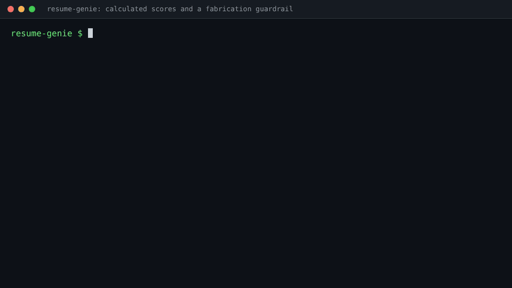
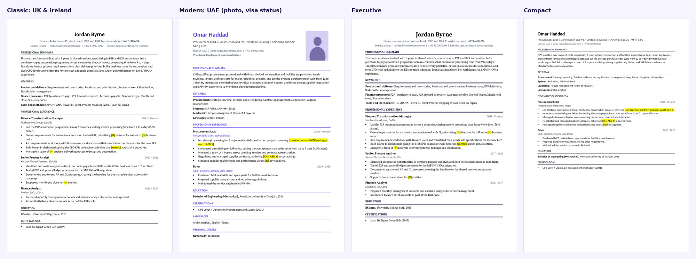
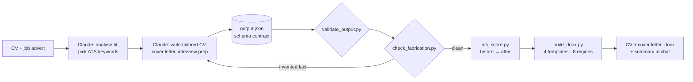

<div align="center">

# Resume Genie

**A Claude skill pack that turns a CV and a job advert into a complete, truthful application:** an honest match analysis, a *calculated* ATS score, a tailored CV and cover letter in the right regional format, and interview prep.

[](https://github.com/DexterslabAi/resume-genie/actions/workflows/ci.yml)


[](LICENSE)

Built by **Rahul Kashyap**

</div>

---

Drag your CV into Claude and paste the job advert. Resume Genie works **in stages**, so you only spend time (and tokens) on the roles worth applying for:

**1. Fit check, always first.** A one-line calculated score and a gap table, nothing else:

> **ATS Score: 57/100**
> **Fit: Stretch.** Strong automation delivery, but no product-ownership title yet.
>
> | Requirement | Priority | Status | Evidence in your CV | How to close the gap |
> |---|---|---|---|---|
> | Product Owner experience | Required | Missing | ... | ... |

**2. Then you choose** from a menu (buttons where the Claude app supports them). Each option runs once; finished ones are marked ✓ and drop out of the menu:

- **Rewrite my CV:** a tailored Word CV in one of four templates and eight regional formats (UK & Ireland, US, Canada, Australia & NZ, Europe, Germany/DACH, UAE & GCC, India), with the ATS score before → after (*57 → 75*).
- **Write a cover letter:** a Word letter built on your real evidence, with gaps handled honestly.
- **Prepare for the interview:** STAR stories from your real experience, likely questions (including the awkward ones about your gaps) and questions to ask.

Every CV rewrite passes **a fabrication audit**: every number, employer and date is checked against the original. Missing figures become highlighted `[placeholders]` for you to fill in, never inventions.



*The real scripts on eval case 1: a calculated ATS score, a clean audit, two planted fabrications caught, and the full suite passing.*



## Why it's different

Most AI CV tools are a single prompt. They guess an ATS score and happily write "increased revenue by 37%". Resume Genie is engineered around one principle: **Claude does the judgement and the writing; deterministic code does everything that must be exact.**

| | Typical AI CV prompt | Resume Genie |
|---|---|---|
| ATS score | Model's guess, changes every run | Calculated: weighted keyword coverage with synonyms + format checks, reproducible |
| Invented metrics | Common | Blocked: placeholders, plus an automated fabrication audit before delivery |
| Proof it works | None | Evaluation suite in CI, including adversarial fabrication tests |
| Output | Text in the chat | Schema-validated JSON → Word files in 4 templates |
| Regional formats | One size fits all | 8 regions: paper, spelling, photo, visa line, personal details, declaration |
| Structure | One big prompt | Orchestrator + 7 specialist skills with progressive disclosure |

## How it works



More detail in [docs/design.md](docs/design.md).

## The skills

| Skill | Use it when you ask… | Bundles |
|---|---|---|
| [`resume-genie`](skills/resume-genie) | "Here's my CV and a job advert" (fit check, then a menu of next steps) | all four scripts, all references, schema |
| [`job-match-analyzer`](skills/job-match-analyzer) | "Should I apply? Am I a good fit?" | `ats_score.py` |
| [`ats-score`](skills/ats-score) | "What's my ATS score for this role?" | `ats_score.py` |
| [`cv-tailor`](skills/cv-tailor) | "Rewrite my CV for this role" | scorer, fabrication check, Word builder |
| [`cover-letter-writer`](skills/cover-letter-writer) | "Write a cover letter" | Word builder |
| [`interview-prep-coach`](skills/interview-prep-coach) | "I have an interview on Friday", including mock interviews | interview reference |
| [`regional-cv-formats`](skills/regional-cv-formats) | "Make this a UAE / German / Indian / US CV" | Word builder, region rules |
| [`finance-transformation-cv`](skills/finance-transformation-cv) | Finance transformation, GBS, ERP and AI-in-finance roles | domain reference |

## Install

**Claude app (claude.ai or desktop):**
1. Turn on **Settings → Capabilities → Create and edit files** (needed for scoring and Word files).
2. Download the skill zips from the [latest release](https://github.com/DexterslabAi/resume-genie/releases), or build them with `python tools/package_skills.py`.
3. Upload each one under **Customize → Skills → + → Upload a skill**. Start with `resume-genie`.

**Claude Code:**
```bash
git clone https://github.com/DexterslabAi/resume-genie.git
cp -r resume-genie/skills/* ~/.claude/skills/
```

**Tip for a job search:** create a Claude Project per person, upload your master CV to the Project's files, and start one chat per job. Each search keeps its own history.

## Example prompts

```
Here's my CV and a job I'm looking at. [attach CV] [paste advert]
Should I apply for this role? Be honest.
What's my ATS score for this advert, and which required keywords am I missing?
Make it a UAE CV. Visa: employment visa (transferable), nationality Indian, notice 30 days. [attach photo]
Switch to the Executive template.
Here are my numbers: team of 6, 40,000 invoices a year. Update the placeholders.
Run a mock interview with me for this role, one question at a time.
```

## Evaluation

Every push runs the evaluation suite ([latest results](evals/RESULTS.md)):

| Case | Region | ATS (calculated) | Fabrication audit |
|---|---|---|---|
| Finance transformation manager → Product Owner | UK & Ireland | 57 → 75 (+18) | clean, 5 placeholders |
| Procurement lead → Procurement Manager | UAE & GCC | 75 → 86 (+11) | clean, 3 placeholders |

**Adversarial suite.** Fabrications are injected into known-good outputs, and the guardrail must catch every one: an invented team size, an inflated percentage, invented revenue, a fake employer, shifted employment dates and an unflagged placeholder. **6/6 caught.**

The candidates and companies in the eval cases are fictional.

## Repository layout

```
skills/                  8 installable skills (each self-contained)
  resume-genie/
    SKILL.md             workflow, rules, file map
    references/          guidance loaded on demand + output schema
    scripts/             ats_score, check_fabrication, validate_output, build_docx
shared/                  single source for scripts and references
tools/                   manifest, sync, lint and packaging
evals/                   cases, adversarial suite, RESULTS.md
tests/                   unit tests (standard-library unittest)
docs/                    design notes and images
```

## Development

```bash
pip install python-docx                     # the only dependency
python -m unittest discover -s tests -t .   # 33 unit tests
python evals/run_evals.py --write           # evaluations + adversarial guardrail suite
python tools/lint_skills.py                 # skill format rules
python tools/sync_shared.py                 # copy shared/ into skills after edits
python tools/package_skills.py              # dist/<skill>.zip for upload
```

Edit scripts and references in `shared/`, then run `sync_shared.py`. CI fails if a skill's copy drifts.

## Author

**Rahul Kashyap.** Finance transformation and AI product leader, Dublin. I design and build agentic AI tools for finance operations.

[LinkedIn](https://www.linkedin.com/in/drahulkashyap90) · GitHub [@DexterslabAi](https://github.com/DexterslabAi)

## Licence

MIT © 2026 Rahul Kashyap. See [LICENSE](LICENSE).
